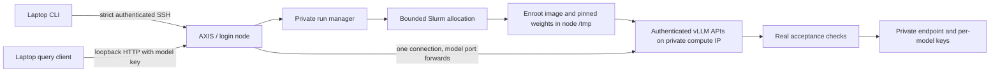

# How the B300 serving framework works

This describes the team review CLI candidate. Its model/API workflows have actual B300/Mac lifecycle checks for GLM,
Ultra, the paired deployment and Safeguard. Shared-base access and other
untested features retain their separate coverage limits. Read the [validation matrix](validation.md) before using it.

## Data and ownership

| Location | Purpose |
| --- | --- |
| Laptop `b300/.runtime/` | Private issued SSH command, transport socket metadata, fetched endpoint/keys. |
| Remote `~/.b300-inference/releases/HASH/` | Immutable checksum-verified serving source, personal to the login. |
| Remote `BASE/b300-site.json` | Team account, partition, QoS and time limits. |
| Remote `BASE/users/LOGIN/runs/RUN_ID/` | Mode-700 personal run: source snapshot, submission receipt, state, logs and active keys. |
| Compute `/tmp/b300-models.JOB.RANDOM/` | Temporary image, weights and writable compiler caches. |

Team sharing grants access to settings and the personal-run parent, not to
another user's private run. The parent is sticky; each personal directory is
owned by its login and mode 700. Slurm project membership remains an external
prerequisite. Another person cannot fetch/cancel a private run through this CLI.
Sharing an existing server with an approved teammate still requires a separate
private endpoint/key handoff; the [direct client](USER_GUIDE.md) supports that
workflow and was exercised with a distinct account.

## Lifecycle

1. The laptop verifies serving hashes and uploads only manifested files. Upload
   completion is marked after remote checksum verification, so an interrupted
   archive is not treated as installed.
2. `up`/`install` locks this user's submission state and checks Slurm. An existing
   active profile is reused as a receipt, not submitted again. Lost replies become
   `submission_uncertain`; automatic retries are blocked.
3. A private run snapshots the source and resolved configuration. Slurm gets an
   explicit GPU count, CPU/memory request, owner, unique name and maximum duration.
4. The batch script prepares Enroot and caches inside the allocation. It preserves
   the event's read-only Slurm/Python-hook mounts. Nemotron preserves the verified
   private writable cubin relocation; global runtime code is not patched.
5. Images and models use pinned digests/revisions. Weight verification checks
   complete shard sets/sizes and configured metadata hashes, not an independent
   hash of every historical weight byte.
6. `install` records its temporary cache and exits. `up` allocates disjoint GPU
   sets, creates a key per model, starts vLLM and runs actual functional checks.
   GLM uses the original seven-check suite and low-reasoning client settings.
7. Only a completely accepted run publishes an endpoint. Fetch checks current
   Slurm ownership/running state and readiness before and after reading keys.
8. The laptop adds both Nemotron forwards to one existing private authenticated
   SSH master. It refuses occupied ports and removes only its own forward specs
   on exit. It rechecks the recorded allocation while forwarding.
9. Slurm expiry, cancellation or server failure stops serving and removes owned
   endpoints/keys. `down` verifies actual queue disappearance; pending cleanup
   is reported explicitly. Node scratch may remain temporarily or be deleted.

The default remote ports are preferred, not guaranteed: if a shared node already
uses one, the server chooses an available private port and records it. Laptop
ports remain explicit and are overrideable. No permanent public endpoint,
unbounded allocation renewal or Kubernetes route is created.

## Important B300 differences

Leonardo's runtime/checkpoint downloads use its internet-enabled CPU queue.
This B300 workflow prepares inside compute allocations and uses their internet
access. Preparation therefore consumes the requested GPU allocation even before
inference. Prefer a single `up` allocation unless separately warming an owned
node cache is intentional.

The old GLM experiments stopped their servers immediately after testing. The new
server retains a successfully checked GLM API until the bounded job ends and
binds it to a private compute IP for forwarding. The retained GLM path was exercised through the Mac in job 12342;
the test stopped it explicitly after evidence collection rather than
retaining it for the full default allocation duration.
